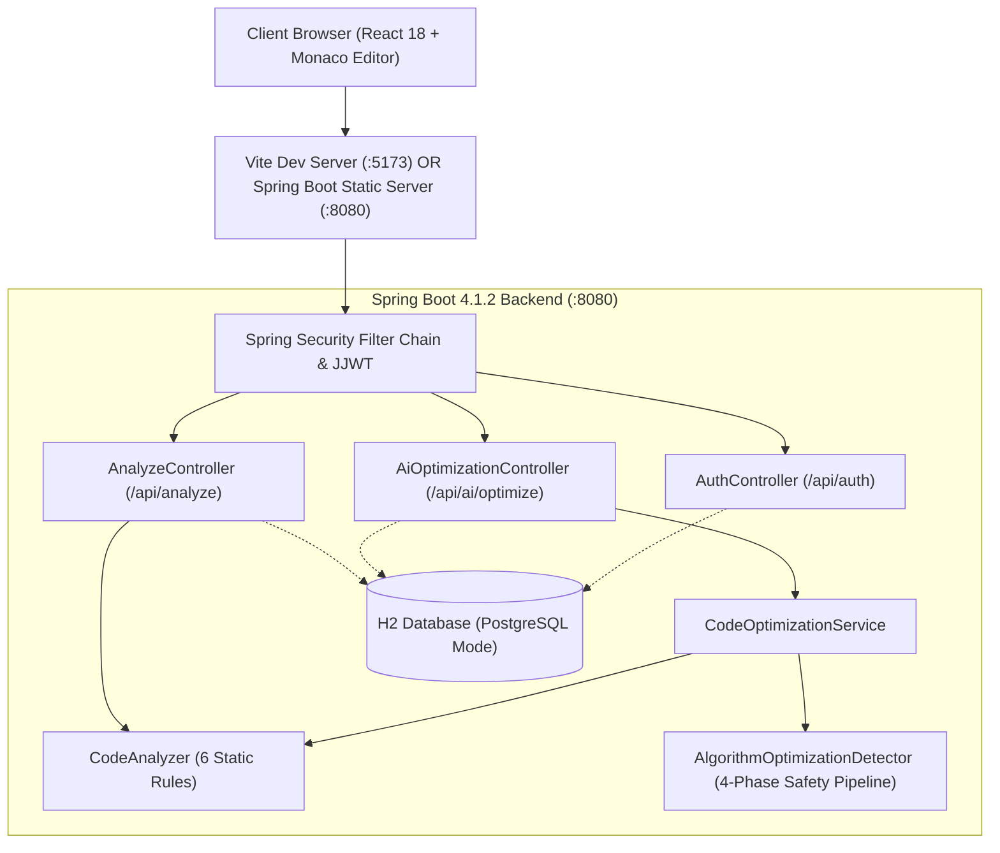

# 🛡️ CodeGuard AI — Autonomous Code Review & Algorithmic Optimization Platform

<p align="center">
  
  
  
  
  
  
  
  
  
</p>

---

## 📌 Overview

**CodeGuard AI** is a production-grade, full-stack static analysis and algorithmic optimization platform designed for modern software engineering teams. It inspects source code for critical security vulnerabilities, code smells, cognitive complexity issues, and architectural anti-patterns, while dynamically detecting quadratic asymptotic bottlenecks ($O(n^2)$) and generating mathematically verified, linear-time ($O(n)\text{ average}$) optimizations.

The project is structured with a high-performance **Java 21 / Spring Boot 4** backend and a reactive **React 18 / TypeScript / Monaco Editor** frontend featuring motion design, interactive complexity visualizers, and split-screen Before/After diff inspections.

---

## ✨ Key Features

### 1. 🔍 Static Code Analysis Engine
- **Null Safety (`NULL_POINTER` - High):** Flags high-risk method calls on unchecked objects (`.length()`, `.toString()`, `.equals()`).
- **Empty Catch Blocks (`EMPTY_CATCH` - Medium):** Catches swallowed exceptions and missing error logging.
- **Production Logging Smells (`SYSTEM_OUT` - Low):** Detects `System.out.println` and advises SLF4J / Logback migration.
- **Cognitive Arrow Anti-Pattern (`DEEP_NESTING` - Medium):** Analyzes scope stack depth and flags if statements nested $\ge 3$ levels deep.
- **Method Maintainability (`LONG_METHOD` - Medium):** Measures method boundary line counts and flags methods exceeding 20 lines.
- **Dead Code Detection (`UNUSED_VARIABLE` - Low):** Uses regex declaration matching and subsequent scope usage scanning to find dead variables.
- **Weighted Quality Score:** Dynamic health score formula: $\text{Score} = 100 - (20 \times \text{High} + 10 \times \text{Medium} + 5 \times \text{Low})$.

### 2. ⚡ AI Algorithmic Optimization & Complexity Engine
- **Pattern-Safe Detection:** Replaces $O(n^2)$ nested loop duplicate detection with $O(n)\text{ average}$ `HashSet` lookups.
- **String Concatenation Optimization:** Detects repeated immutable `String +=` operations in loops and refactors to `StringBuilder` buffer appending.
- **List Membership Optimization:** Flags repeated linear `List.contains()` in loops ($O(n \times m)$) and converts target collections to `HashSet` ($O(n + m)$).
- **Exponential Recursion Elimination:** Refactors naive recursive trees ($O(2^n)$) into iterative Dynamic Programming ($O(n)$ time, $O(1)$ space).
- **Complexity Visualizer:** Interactive horizontal bar visualizer illustrating algorithmic speedups and memory trade-offs.
- **Split-Screen Before/After View:** Side-by-side comparison with interactive diff tabs and 1-click apply with non-destructive undo.

### 3. 🔐 Enterprise Authentication & Audit Trail
- **Spring Security & JJWT (0.12.6):** Stateless JWT authentication with BCrypt password hashing.
- **In-Memory & Cloud Database Support:** Out-of-the-box H2 database in PostgreSQL compatibility mode, seamlessly portable to managed AWS RDS / Supabase / Neon PostgreSQL.
- **Analysis & Optimization History:** Full historical tracking of user audits and optimizations with 1-click restore.

### 4. 🌐 Internet & Cloud Ready
- **Self-Contained Full-Stack Deployment:** Spring Boot automatically bundles and serves the production React frontend. A single JAR runs the complete system.
- **Universal Containerization:** Production multi-stage `Dockerfile` ready for 1-click deployment on Render, Railway, Fly.io, or AWS.
- **Graceful Client Fallback:** If the backend is waking up or offline, the client engine continues running analysis seamlessly in the browser.

---

## 🏛️ System Architecture



---

## 🚀 Live Cloud Deployment (Visible to All on Internet)

You can deploy CodeGuard AI for **free** so anyone on the internet can use it:

### Option 1: 1-Click Free Deployment on Render.com (Recommended)
1. Fork or push this repository to your GitHub account.
2. Sign up at [Render.com](https://render.com) and click **New +** $\to$ **Web Service**.
3. Connect your GitHub repository.
4. Select **Docker** as the Runtime (it will automatically use the included multi-stage [`Dockerfile`](./Dockerfile)).
5. Set:
   - **Instance Type:** Free
   - **Environment Variable:** `PORT=8080`
6. Click **Deploy Web Service**!
7. Render will provide a public live URL (e.g. `https://codeguard-ai.onrender.com`) that serves the full-stack application to anyone worldwide.

### Option 2: Deploy Frontend on Vercel + Backend on Render/Railway
- **Frontend (Vercel):**
  1. Go to [Vercel](https://vercel.com) and import the repository.
  2. Set **Root Directory** to `frontend`.
  3. Under Environment Variables, set `VITE_API_BASE_URL` to your backend URL.
  4. Click **Deploy**!
- **Backend (Render / Railway):**
  1. Deploy using the included Dockerfile or Maven build (`./mvnw clean package`).

---

## 💻 Local Setup & Quickstart

### Prerequisites
- **Java:** JDK 21+
- **Node.js:** v18+ or v20+
- **Git**

### 1. Clone the Repository
```bash
git clone https://github.com/your-username/CodeGuardAI.git
cd CodeGuardAI
```

### 2. Single-Command Launch (Windows)
Run the automated launcher:
```cmd
.\start.bat
```
*(Or in PowerShell: `.\run.ps1`)*

### 3. Manual Launch

#### Run Backend (Spring Boot :8080):
```bash
cd backend
# Windows
.\mvnw.cmd spring-boot:run

# Linux / macOS
chmod +x mvnw
./mvnw spring-boot:run
```

#### Run Frontend (React Vite :5173):
```bash
cd frontend
npm install
npm run dev
```

Visit **`http://localhost:5173`** in your browser.

---

## 🧪 Running Automated Tests

CodeGuard AI includes comprehensive test suites across backend and frontend:

```bash
# Run all 14 Spring Boot unit tests
cd backend
.\mvnw.cmd test

# Run frontend TypeScript type checking and production build
cd frontend
npm run build
```

---

## 📡 API Reference

### 1. Analyze Source Code
- **URL:** `POST /api/analyze`
- **Headers:** `Content-Type: text/plain`
- **Body:** Raw Java source code
- **Sample Response:**
```json
{
  "lineCount": 14,
  "score": 90,
  "highCount": 0,
  "mediumCount": 1,
  "lowCount": 0,
  "issues": [
    {
      "severity": "MEDIUM",
      "line": 3,
      "type": "ALGORITHM_OPTIMIZATION",
      "message": "Quadratic O(n²) duplicate detection detected using nested loops.",
      "suggestion": "Replace O(n²) nested-loop duplicate detection with O(n) average-case HashSet lookup."
    }
  ],
  "optimization": {
    "type": "ALGORITHM_OPTIMIZATION",
    "title": "Optimize duplicate detection",
    "originalComplexity": "O(n²)",
    "optimizedComplexity": "O(n) average",
    "spaceComplexity": "O(n)",
    "explanation": "The original implementation compares every pair of elements using nested loops. A HashSet allows average O(1) lookup for each element.",
    "tradeoff": "The optimized solution uses additional O(n) memory.",
    "recommendation": "Replace O(n²) nested-loop duplicate detection with O(n) average-case HashSet lookup."
  }
}
```

### 2. Algorithmic Optimization
- **URL:** `POST /api/ai/optimize`
- **Headers:** `Content-Type: application/json`
- **Body:**
```json
{
  "code": "public static boolean findDuplicateSlow(int[] numbers) { ... }",
  "language": "java"
}
```

---

## 📂 Project Structure

```text
CodeGuardAI/
├── .github/
│   └── workflows/
│       └── ci.yml               # Automated GitHub Actions CI pipeline
├── backend/
│   ├── src/
│   │   ├── main/
│   │   │   ├── java/com/codeguard/backend/
│   │   │   │   ├── analyzer/     # CodeAnalyzer & AlgorithmOptimizationDetector
│   │   │   │   ├── config/       # SecurityConfig, JWT Filter, CORS
│   │   │   │   ├── controller/   # REST Controllers (Analyze, Optimize, Auth)
│   │   │   │   ├── dto/          # Data Transfer Objects
│   │   │   │   ├── entity/       # JPA Entities (User, AnalysisHistory)
│   │   │   │   ├── repository/   # Spring Data JPA Repositories
│   │   │   │   └── service/      # CodeOptimizationService, UserService, JwtService
│   │   │   └── resources/
│   │   │       ├── application.properties
│   │   │       └── static/       # Bundled React production assets
│   │   └── test/                 # JUnit 5 test suites (14 tests)
│   └── pom.xml
├── frontend/
│   ├── src/
│   │   ├── components/           # ScoreDashboard, ComplexityVisualizer, Modal, Monaco
│   │   ├── services/             # Axios API service & local client engine
│   │   ├── types/                # TypeScript interface definitions
│   │   ├── utils/                # Motion hooks & animation helpers
│   │   ├── App.tsx
│   │   └── main.tsx
│   ├── package.json
│   ├── tailwind.config.js
│   ├── tsconfig.json
│   ├── vercel.json               # Vercel deployment configuration
│   └── vite.config.ts
├── Dockerfile                    # Production multi-stage Docker build
├── .gitignore
├── start.bat                     # Windows CMD quick launcher
├── run.ps1                       # Windows PowerShell quick launcher
└── README.md                     # Documentation & portfolio showcase
```

---

## 📄 License

This project is licensed under the MIT License - see the [LICENSE](LICENSE) file for details.
